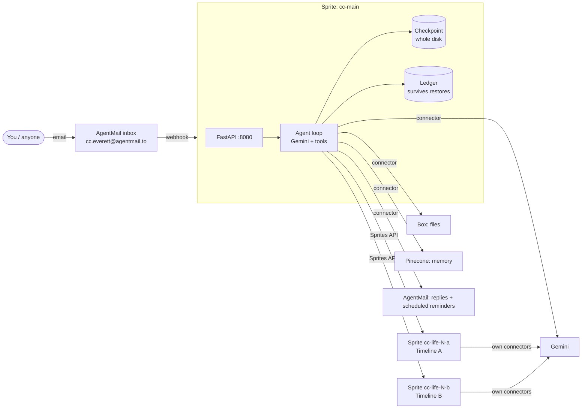

# Everett

**CC Everett. It remembers everything, undoes anything, and lives your other lives so you don't have to guess.**

Everett is a chief of staff that lives inside its own computer, a [Fly.io Sprite](https://sprites.dev), and works entirely over email. Forward it a lease, a bill or a receipt, or just ask it something. It files the attachments, remembers the facts, schedules reminders and replies in the thread.

Before every action it takes a checkpoint of its whole computer. If you reply "undo", it reverses the action and rewinds the machine.

When you can't decide between two options, it creates a separate computer for each one. Each computer lives through a year of that future and writes you a letter from it. You pick one, and Everett destroys the other.

> **Try it:** email **cc.everett@agentmail.to**. Anyone can. Each sender gets a private space with separate memory, files, reminders and dashboard.
>
> **Live page:** [cc-main-hezx.sprites.app](https://cc-main-hezx.sprites.app/about) has live stats and one-click example emails. Opening it wakes the Sprite up.
>
> **Demo video:** _link coming soon_

Named after Hugh Everett, the physicist behind the many-worlds interpretation.

---

## What it does

| You email… | Everett… |
|---|---|
| A bill, lease, receipt or ticket (PDF or photo) | reads it, files it to **Box** under a tidy folder (`Finance/Receipts/…`), and remembers the amount, dates and names in **Pinecone** |
| "Remind me 3 days before it's due" | schedules the reminder as an **AgentMail** scheduled reply, with the amount, the real deadline and the Box link inside, and attaches a **calendar invite** (`.ics`). The reminder arrives in the same thread on time, even while the Sprite is asleep |
| `done` / `snooze 2h` / `snooze tomorrow` (replying to a reminder) | closes the reminder, or moves the scheduled email to the new time. Handled instantly, without a model call, and undoable |
| "How much was the bike repair?" | answers from long-term memory |
| `undo` | reverses the last run's side effects, then **restores the whole Sprite to the checkpoint taken just before it** |
| "Help me decide: should I spend Thanksgiving week building a hackathon project, or with my family?" | **Parallel Lives**: one new Sprite per option, each lives a year of that future, you get a letter from each timeline plus a comparison |
| `choose B` | collapses the other timeline (its Sprite is destroyed), remembers the decision, sends first steps |
| Someone emails you and CCs Everett | **observe mode**: quietly takes notes for you (marked *unverified*), never replies to them |

Every run appears on a private **timeline dashboard**, which shows each action, the checkpoint taken before it, an Undo button, upcoming reminders and the Parallel Lives reports.

---

## How it works



**No API keys live on the machine.** Gemini, Box, Pinecone and AgentMail are all reached through **Sprites connectors**. The credentials stay in Fly's vault, and the Sprite calls `https://api.sprites.dev/v1/gateway/<provider>/<id>/…` with no auth header; the gateway identifies the Sprite by its request signature. Access is granted per Sprite name prefix (`cc-`), so the timeline Sprites inherit access automatically.

### One email, start to finish
1. AgentMail fires `message.received` at `POST /webhooks/agentmail`. Everett acks immediately and works in the background under a keep-awake task, so the Sprite doesn't sleep mid-task.
2. It **re-fetches the message from AgentMail by id** and ignores the webhook body, so a forged webhook does nothing.
3. It checks the sender's **SPF/DKIM/DMARC** results (see [Security](#security)) and routes the mail to the owner's space or to that sender's private guest space.
4. It builds the prompt: the email, attachments (PDFs and images inlined), thread history, relevant memories and upcoming reminders, all fenced as untrusted data.
5. **Gemini** runs a tool loop: `remember`, `recall`, `file_attachment`, `set_reminder`, `cancel_reminder`, `start_parallel_lives`, `set_timezone`, `report_manipulation`.
6. **The first state-changing tool call triggers a checkpoint** of the whole Sprite (`sprite-env checkpoints create`, about 1 second, copy-on-write).
7. It replies in the thread with what it did, an undo hint and a link to the sender's timeline.

### Undo, or time travel
A disk checkpoint can't unsend an email or un-upload a file, so undo has two parts:

1. **Compensating actions** for everything outside the Sprite. Memories are deleted from Pinecone, reminder drafts are deleted from AgentMail, timeline Sprites are destroyed, and Box filings are retired (see the field notes on why that isn't a delete).
2. **Disk restore.** If this was the newest run, Everett replies first and then runs `sprite-env checkpoints restore vN`. The whole computer, including the local vault copy of filed documents, rewinds to the moment before the run.

The **ledger** (runs, actions, undo history) lives on `/tmp`, which sits on a separate disk that restores don't rewind. That makes it a flight recorder: after the rewind, the dashboard still shows *"run #3 undone, disk rewound to v13"*. A guard refuses to restore a checkpoint older than the last deploy, because a restore also rewinds the code.

### Parallel Lives
1. `start_parallel_lives` creates one Sprite per option (`cc-life-<id>-a`, `-b`) through the Sprites REST API. The Free plan allows 3 Sprites, so that's `cc-main` plus 2 timelines, and older timelines are collapsed first.
2. Each timeline receives `life_worker.py` (stdlib only) and a brief via `fs/write`, then runs it through HTTP exec.
3. The worker calls Gemini **through its own connectors** to live one year of that future. It writes a diary, a monthly budget, wins and hardships, and first steps, and it **emails you a letter from that timeline** through AgentMail.
4. Everett gathers the reports, has Gemini write a candid comparison and emails it to you. Reply `choose A` or `choose B`, and the losing Sprite is destroyed while the winner stays asleep as an archive of that future.

### Reminders without a cron job
A sleeping Sprite only wakes on HTTP, so nothing inside it can run on a timer. Instead of polling, Everett hands each reminder to AgentMail as a **scheduled reply draft** (`POST /drafts` with `in_reply_to` and `send_at`). AgentMail sends it at the right time, in the right thread, while the Sprite sleeps. Cancelling or undoing a reminder deletes the draft. If scheduling ever fails, the reminder falls back to a ledger entry that goes out on the next wake (any email, or `GET /tick`).

---

## Security

Everett is an AI with access to your documents that **anyone on the internet can email**, so it's built to assume hostile input.

| Threat | Defence |
|---|---|
| **Someone forges an email "from" the owner** | Owner access requires **DMARC pass**, or a DKIM signature from the sender's own domain. A forgery is blocked: no action, no reply. The real owner gets an "⚠️ Someone tried to impersonate you" alert (at most one per hour) and the attempt is logged on the timeline. |
| **Prompt injection** in an email, attachment or forwarded thread | Three layers. (1) All outside content is wrapped in a **per-run random fence** and declared data, never instructions. (2) A **phrase scanner** catches known attacks (*ignore previous instructions*, fake `[system]` markers…) and **quarantines** the run before the model sees it. (3) The model can quarantine the run itself with `report_manipulation`. In a quarantined run, every state-changing tool is locked and the reply carries a 🛡️ warning. |
| **Memory poisoning** by a third party who CCs Everett | Notes taken in observe mode are stored as *unverified, heard from X*, and the model is told never to present them as the owner's words. |
| **Forged webhooks** | Every event is re-fetched from AgentMail by id; anything that isn't really in the inbox is dropped. Svix signature verification is also supported. |
| **Data exfiltration** | Everett **cannot email anyone except the sender of the current email**; there is no "send to anyone" tool. Even a successful hijack has nowhere to send data. |
| **Guests seeing each other's data** | Each sender gets a tenant with a separate Pinecone namespace, Box folder, reminders, undo history and dashboard. |
| **Leaked or forwarded email links** | Emails never carry the master key. Each link is a **signed, expiring, single-tenant token** (14 days; reminder links count from when they fire). The first click exchanges it for an `HttpOnly`, `Secure`, `SameSite=Lax` session cookie and strips it from the URL. Redirects stay inside the tenant's own space. |
| **Clickjacking / CSRF on the Undo buttons** | `X-Frame-Options: DENY` plus CSP `frame-ancestors 'none'`. Cross-site POSTs carry no session cookie. Also `Referrer-Policy: no-referrer`, `Cache-Control: no-store`, HSTS, and a strict CSP. |
| **Abuse of free credits** | Guests are capped at 15 runs and 2 Parallel Lives per day. |
| **Leaked API keys** | There are none on the machine to leak. All credentials sit in Fly's connector vault. |
| **"What if it gets tricked anyway?"** | Every state change is preceded by a checkpoint, so you can reply `undo`. |

---

## Built with

| | |
|---|---|
| **Fly.io Sprites** | the agent's body: persistent VM, checkpoints and restore, services, the HTTP exec and filesystem APIs, the Sprites REST API for timeline Sprites |
| **Sprites connectors** | Gemini, AgentMail, Box, Pinecone, plus a Custom API connector (see field notes) |
| **AgentMail** | the inbox, webhooks, threaded replies, scheduled drafts for reminders |
| **Box** | document filing |
| **Pinecone** | long-term memory (integrated index `llama-text-embed-v2`, records API, one namespace per tenant) |
| **Gemini** | reasoning, tool use, reading PDFs and images (free tier, with a model fallback chain) |
| **Python 3.13 · FastAPI · SQLite · httpx** | the rest |

---

## Field notes (things we learned the hard way)

These cost us hours; maybe they'll save you some.

- **The AgentMail connector rejects any path containing `=`.** Gmail Message-IDs almost always contain one (`<CAD3x…=7q…@mail.gmail.com>`). The fix is to **URL-encode the id twice**: the gateway decodes one layer, AgentMail decodes the other.
- **The AgentMail connector blocks attachment downloads and webhook management.** Attachments go through a **Custom API connector** pointed at `https://api.agentmail.to` with the same key, which still keeps the key out of the Sprite. The webhook is registered once in the AgentMail console.
- **The Box connector allows upload but not delete, move or edit.** Undo uploads a new *version* of the file (allowed), replacing it with a note and renaming it `(undone) …`. The original stays in Box's version history.
- **The Pinecone connector doesn't support the 2026 documents API or index creation.** Create a *legacy integrated index* (`create-for-model`, API version `2025-04`) yourself (`scripts/create_pinecone_index.sh`) and use the records API (`/records/namespaces/<ns>/upsert|search`).
- **Checkpoint restore rewinds `/` but not `/tmp`,** which is a separate disk. That is where state that must survive time travel belongs.
- **On the free tier the Gemini flash models can be overloaded** (503s or 60-120 s hangs). Keep a fallback chain with short timeouts. When switching models in the middle of a tool loop, newer models require a `thoughtSignature` on transferred `functionCall` parts; use the documented placeholder `skip_thought_signature_validator`.
- **A Sprite can drive its own checkpoints** (`sprite-env checkpoints create|list|restore`). Restore restarts the environment, so send any reply *before* restoring.

---

## Run your own

You need a Fly.io account with Sprites, the `sprite` CLI (`curl -fsSL https://sprites.dev/install.sh | sh`, then `sprite login`), and accounts for AgentMail, Box, Pinecone and Google AI Studio (Gemini). All have free tiers.

1. **Create the Sprite:** `sprite create cc-main`, then `sprite url update --auth public -s cc-main` so webhooks can reach it.
2. **Connect providers** in the Fly dashboard → org → *Connectors*: Gemini, AgentMail, Box and Pinecone, plus a *Custom API* connector named `AgentMail Full` (base URL `https://api.agentmail.to`, Bearer auth with your AgentMail key). Give each an access policy with name prefix `cc-`.
3. **Create the memory index:** `./scripts/create_pinecone_index.sh` (prompts for your Pinecone key; the key is used once and never stored).
4. **Point the code at your inbox and URL:** set `CC_INBOX` and `CC_PUBLIC_URL` (defaults are in `agent/app/config.py`).
5. **Deploy:** `./scripts/deploy.sh`. It uploads `agent/` to the Sprite, installs dependencies into a uv venv and runs a Sprite service on :8080.
6. **Settings** (stored on the Sprite in `~/.cc-secrets/env`, never in the repo):
   ```bash
   ./scripts/set_secret.sh CC_OWNER_EMAILS "you@example.com"   # who the owner is
   ./scripts/set_secret.sh CC_TIMEZONE America/New_York        # owner's default timezone
   ./scripts/set_secret.sh SPRITES_TOKEN                       # for Parallel Lives (prompts, hidden)
   ./scripts/set_secret.sh CC_WEBHOOK_SECRET                   # optional: Svix signing secret
   ```
7. **Webhook:** in the AgentMail console, add `https://<your-sprite-url>/webhooks/agentmail` for `message.received`.
8. Email your inbox. Every reply links to your timeline. To sign in to the admin dashboard directly, run `./scripts/login_link.sh` for a fresh 14-day link.

Useful commands:
```bash
sprite exec -s cc-main -- tail -f /.sprite/logs/services/cc.log   # live logs
curl https://<your-sprite-url>/health                              # health check
sprite exec -s cc-main -- sprite-env checkpoints list              # the time machine
```

### Cost
Sprites bill CPU and memory only while awake. Everett sleeps between emails, and wakes on the webhook for about 10-30 seconds per email. Timeline Sprites work for under a minute and are then destroyed or left asleep. Reminders cost nothing, because AgentMail sends them. Every model call uses Gemini's free tier.

---

## Repository layout

```
agent/
  requirements.txt
  app/
    main.py         HTTP surface: webhook, dashboard, undo buttons, /tick, /health
    agent.py        email routing, authentication gate, prompt + injection guard, Gemini tool loop, undo
    tools.py        the tools Gemini can call, tenants, timezones, quarantine
    gw.py           connector clients: AgentMail, Box, Pinecone, Gemini (fallback chain)
    sprite.py       checkpoints, keep-awake tasks, Sprites REST API client
    lives.py        Parallel Lives orchestration and timeline choice
    life_worker.py  runs inside each timeline Sprite (stdlib only)
    reminders.py    fallback reminder sender
    dashboard.py    server-rendered timeline pages
    db.py           SQLite ledger (on /tmp, survives restores)
    config.py       settings and tenant helpers
scripts/
  deploy.sh                  ship agent/ to the Sprite and (re)start the service
  set_secret.sh              set a setting/secret on the Sprite
  login_link.sh              print a fresh signed dashboard link
  create_pinecone_index.sh   create the legacy integrated index
```

---

Built for **Fly.io Hacksgiving 2026**.
